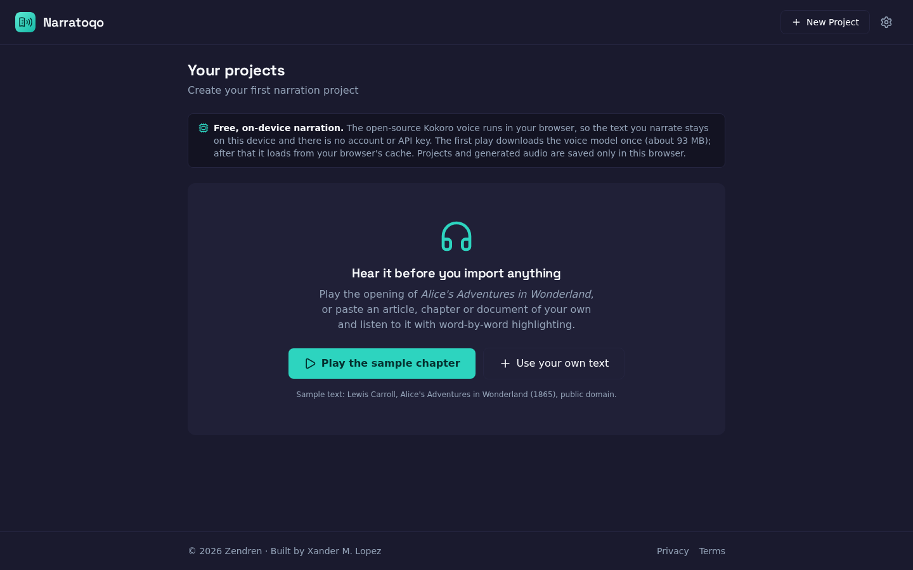
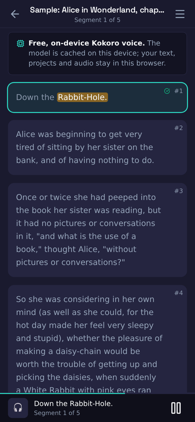

# Narratoqo

Free audiobook narration in the browser: paste text, import an article or open a file, and hear it read by neural voices that run on your device, with word-by-word highlighting.

**Live:** https://narratoqo.vercel.app. No account, no payment and no API key. The neural voices (Kokoro and Piper) run locally through WebAssembly, so the text you narrate stays on your device. Projects and generated audio are saved in your browser.

| Desktop | Mobile |
|---|---|
|  |  |

## What it does

- **One-click sample.** *Play the sample chapter* creates a project from the opening of *Alice's Adventures in Wonderland* (public domain) and starts narrating it.
- **On-device neural voices.** [Kokoro 82M](https://huggingface.co/onnx-community/Kokoro-82M-v1.0-ONNX) (q8, English, 12 voices) is the default. [Piper](https://github.com/rhasspy/piper) offers 18 voices across 10 languages. Both run on the ONNX Runtime WebAssembly backend. The browser's built-in Web Speech voice is a fallback that needs no download.
- **Honest first run.** Before the first play, the app states the one-time model download (Kokoro: about 93 MB; Piper's default voice: about 63 MB). It shows byte progress while downloading and caches the model, so later visits load it from the browser.
- **Reading view.** The text is split into segments you can click to play. Audio is generated on demand, the next segments preload, every segment is cached in IndexedDB, and the current word is highlighted.
- **Import.** Paste text, fetch an article by URL (through a public CORS proxy) or open a TXT, Markdown or HTML file. Export the narration as audio.
- **Optional cloud voices.** OpenAI, Gemini, ElevenLabs, PlayHT and Deepgram work with your own key. The key is kept in this browser tab's session storage, which is cleared when the browser closes. It is sent only to that provider, and that provider bills your account. There is no Narratoqo server.

## Measured first-audio time

Measured on 2026-11-06 with Playwright (headless Chromium, WASM backend) against a production build served locally with the `vercel.json` headers. The timer runs from clicking *Play the sample chapter* to the first audio starting, over four runs at 1440×900 and 390×844.

| Case | Click to first audio |
|---|---|
| First visit, including the one-time 93 MB model download | 8.7 s, 9.0 s and 9.2 s; one run took 22.1 s (cold CDN fetch) |
| Model already cached in the browser, fresh page load | 4.0 s to 4.3 s |

These runs used a 12-thread desktop CPU shared with other work, over a home connection. Download time depends on the connection and synthesis speed on the CPU. On slower phones a long paragraph can take longer to generate than to play, so the app generates the next segments while the current one plays.

## Stack

React 19, TypeScript, Vite 7, Tailwind CSS 4, Zustand, Dexie (IndexedDB), Howler.js, kokoro-js / Transformers.js 3.8, @mintplex-labs/piper-tts-web with onnxruntime-web 1.23, and Vitest with Testing Library. CI runs on GitHub Actions with Node 22, and the app is hosted on Vercel (Hobby plan, static site, no serverless functions).

## Run locally

Requires Node 22 (see `.nvmrc`).

```bash
git clone https://github.com/XanderXML-Bit/narratoqo-app.git
cd narratoqo-app
npm ci --onnxruntime-node-install-cuda=skip
npm run dev        # http://localhost:5173
```

`@huggingface/transformers` depends on `onnxruntime-node`, whose install script tries to download optional CUDA binaries, and that download can fail on Linux. The flag above skips it. The browser app uses the WebAssembly runtime and never needs CUDA.

| Script | What it does |
|---|---|
| `npm run build` | Type-checks (`tsc -b`) and builds to `dist/` |
| `npm run lint` | ESLint |
| `npm test` | Vitest unit and component tests |
| `npm run preview` | Serves the production build locally |

## Configuration

The web app needs no environment variables. Configure voice and playback preferences in Settings.

| Setting | Default | Where it is stored |
|---|---|---|
| Voice provider | Kokoro (on-device) | `localStorage` |
| Voice | `af_heart` (Kokoro) | `localStorage` |
| Cloud provider API keys | none (optional) | `sessionStorage` (cleared when the browser closes) |
| Projects and generated audio | none | IndexedDB |
| Downloaded voice models | none | Cache Storage (Kokoro), Origin Private File System (Piper) |

On-device models and runtimes load from Hugging Face (`huggingface.co`, `*.hf.co`) and from version-pinned jsDelivr paths. The Content-Security-Policy in `vercel.json` and `index.html` allows those version-pinned runtime paths plus the Hugging Face model hosts (the `*.hf.co` entry is a wildcard). `src/csp.test.ts` fails if a dependency upgrade changes the runtime versions without updating the CSP.

### Configure AdMob for native builds

The web app runs without ads. The native ad service requires both IDs for the target platform. See `.env.example` for the variable names.

1. Export the platform's app ID and interstitial unit ID in your build shell.
2. Run `npm run build`.
3. Run `npx cap sync android` or `npx cap sync ios` for your target.
4. For Android, run Gradle from the same shell. For iOS, pass `VITE_ADMOB_IOS_APP_ID="$VITE_ADMOB_IOS_APP_ID"` to `xcodebuild` or set it in Xcode.

The public app has no interstitial placements.

## Deploy

The app is a static site. `npm run build` writes it to `dist/`, and the live copy is hosted on Vercel. `vercel.json` routes `/`, `/project/*`, and `/privacy` to the single-page app and sets security headers. Other paths return the styled `404.html` with HTTP 404.

The Capacitor iOS and Android projects in `ios/` and `android/` are not part of the web deployment.

## Brand

Zendren -oqo consumer family. Signature accent teal `#2dd4bf` (text on it `#042f2e`) on a `#1a1a2e` dark surface. Display face Space Grotesk (self-hosted); the body uses the system UI font. Logo files: `public/brand/mark.svg` and `public/brand/wordmark.svg`.

## Third-party models

Voice models are downloaded at run time and are not part of this repository. See [THIRD-PARTY-NOTICES.md](THIRD-PARTY-NOTICES.md).

## License

All rights reserved. See [LICENSE](LICENSE). © Zendren.
